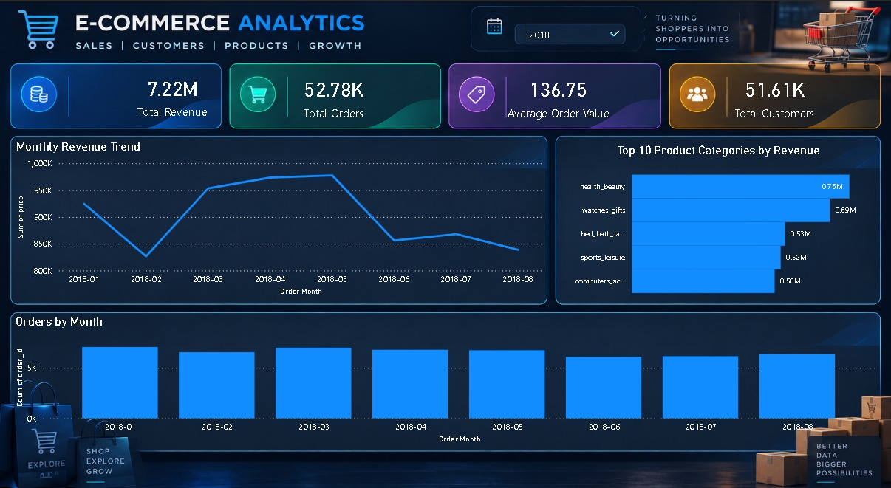
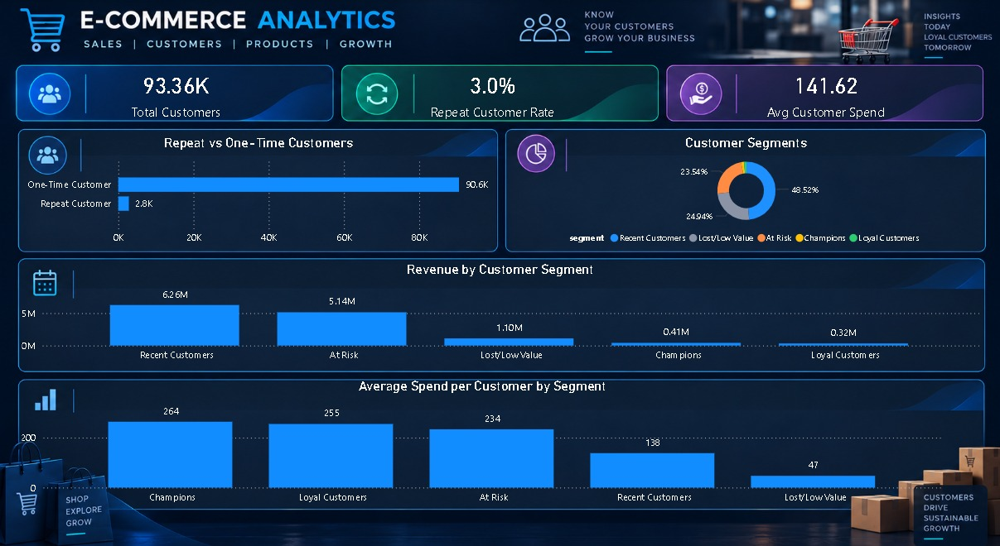
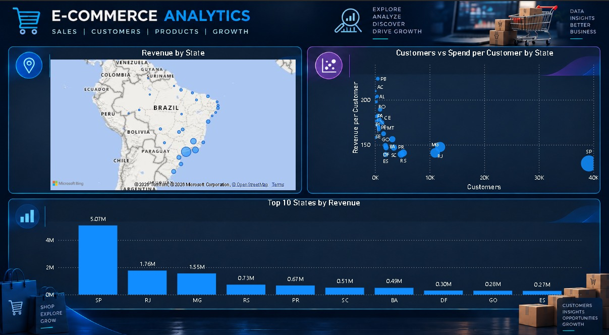

# E-Commerce Sales & Customer Analytics

An end-to-end analytics project on the Olist Brazilian e-commerce dataset. Raw CSV files are cleaned with Python and Pandas, loaded into a SQL database, analysed with SQL, and presented in a 3-page Power BI dashboard.

## Business Questions

- How are revenue and orders trending over time?
- Which product categories and states drive the most revenue?
- Who are our customers, and how many of them come back?
- Which customer segments are worth the most?

## Dashboard

### Sales Overview


### Customer Analytics


### Geography & Segments


## Key Insights

- **Revenue:** 13.22M BRL from 96.48K delivered orders, with an average order value of 137.04 BRL.
- **Growth:** Monthly orders rose steadily through 2017, peaked in November 2017, and stayed roughly flat through 2018.
- **Categories:** The top 5 categories (health_beauty, watches_gifts, bed_bath_table, sports_leisure, computers_accessories) bring in about 40% of revenue.
- **Geography:** São Paulo alone generates about 38% of revenue, and São Paulo, Rio de Janeiro and Minas Gerais together generate about 63%.
- **Retention is the weak spot:** Only 3.0% of the 93,358 customers ordered more than once.
- **Repeat buyers are worth more:** Champions spend about 264 BRL per customer, against 47 BRL for Lost/Low Value customers.

## Method

1. **Cleaning (Python, Pandas):** converted date columns to real dates, filled missing product categories with "unknown", and saved cleaned tables.
2. **Database (SQLite, SQLAlchemy):** loaded 8 cleaned tables into a SQLite database and joined them with SQL.
3. **Analysis (SQL, Pandas):** monthly revenue, top categories, and RFM (Recency, Frequency, Monetary) customer segmentation.
4. **Dashboard (Power BI):** built a data model, DAX measures and 3 report pages.

### Data lesson: customer_id vs customer_unique_id

In Olist, `customer_id` is generated again for every order, so one person who orders twice gets two different IDs. Grouping by `customer_id` hid every repeat buyer. All customer metrics use `customer_unique_id`, which identifies the real person.

## Limitations

- The data covers September 2016 to August 2018, and the first and last months are partial.
- Repeat purchases are rare (3%), so a month-by-month cohort retention table would be almost empty and was left out.
- All amounts are in Brazilian reais (BRL).

## Tools

Python (Pandas, SQLAlchemy, Matplotlib), SQLite, SQL, Power BI Desktop, DAX, VS Code, Git

## Project Structure

```
ecommerce-analytics/
├── notebooks/     Python notebooks (cleaning, SQL analysis, RFM)
├── dashboard/     Power BI report (.pbix)
├── images/        Dashboard screenshots
├── requirements.txt
└── README.md
```

## How to Reproduce

1. Download the dataset from [Kaggle: Brazilian E-Commerce by Olist](https://www.kaggle.com/datasets/olistbr/brazilian-ecommerce) and put the CSV files in `data/raw/`.
2. Create a virtual environment and run `pip install -r requirements.txt`.
3. Run the notebooks in `notebooks/` in order.
4. Open the Power BI report in `dashboard/`.

## Data Source

Olist Brazilian E-Commerce Public Dataset on Kaggle, licensed CC BY-NC-SA 4.0. The Power BI report contains an embedded copy of the cleaned data, shared here under the same license with attribution to Olist. The original raw CSV files are not included in this repository.
## Notebook Notes

- 01_exploration.ipynb: cleaning and sales analysis. Its customer section (RFM, repeat vs one-time, cohort retention) is the first attempt and groups by customer_id, so it is superseded.
- 02_customer_analysis.ipynb: the corrected customer analysis using customer_unique_id. The Power BI dashboard uses this version.
